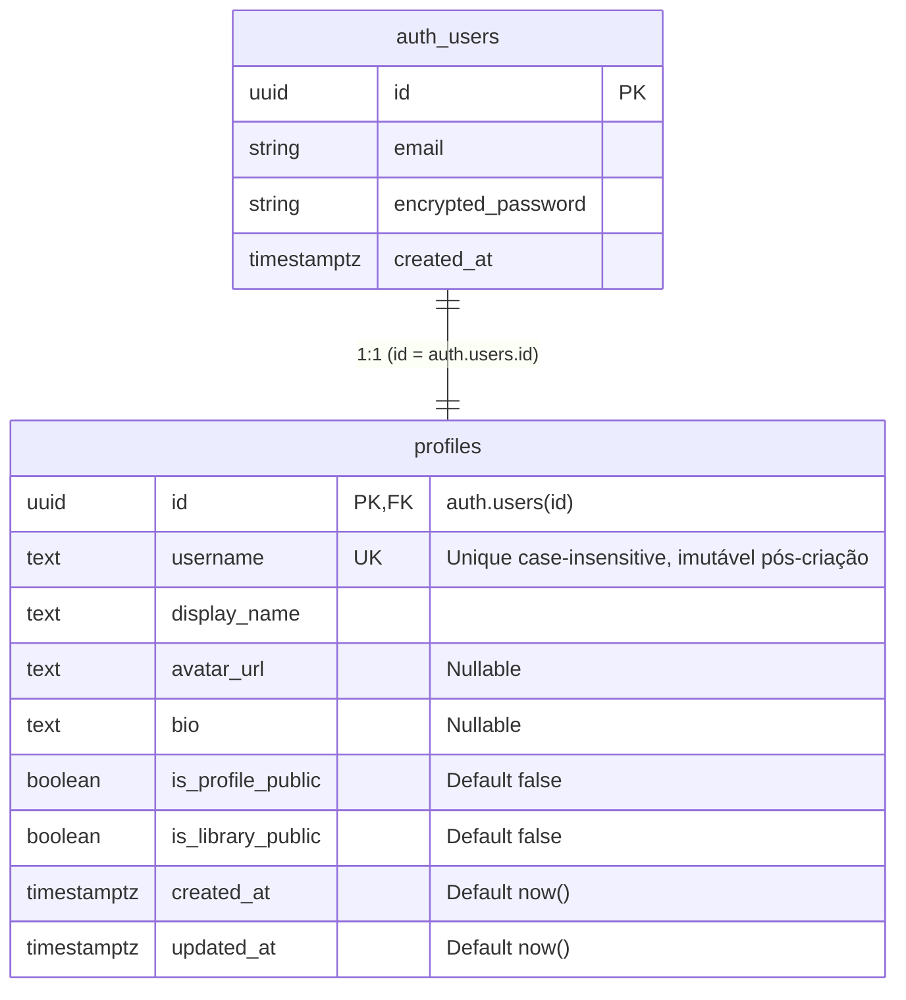

# Data Model: Authentication & User Profiles

**Feature**: `001-auth-user-profiles`  
**Date**: 2026-11-07  
**Database**: PostgreSQL (Supabase)  
**Security Status**: Hardened (SEC-001, SEC-002, SEC-003 incorporados)

## 1. Entidades e Relacionamentos



---

## 2. Especificação da Tabela `public.profiles`

### 2.1. Estrutura de Colunas

| Coluna | Tipo | Nulável | Padrão | Restrições / Validações | Descrição |
|---|---|:---:|---|---|---|
| `id` | `UUID` | Não | — | `PRIMARY KEY`, `REFERENCES auth.users(id) ON DELETE CASCADE` | Identificador do perfil, idêntico ao ID do usuário no Supabase Auth |
| `username` | `TEXT` | Não | — | `UNIQUE (LOWER)`, `3 <= length <= 20`, `^[a-zA-Z0-9_-]+$`, **Imutável** | Identificador público único do usuário na plataforma (imutável pós-criação) |
| `display_name` | `TEXT` | Não | — | `2 <= length <= 50` | Nome de exibição amigável do jogador |
| `avatar_url` | `TEXT` | Sim | `NULL` | Formato URL válido se preenchido | Caminho ou link para foto de perfil |
| `bio` | `TEXT` | Sim | `NULL` | `length <= 300` | Breve biografia ou apresentação do jogador (sanitizada de tags e espaços) |
| `is_profile_public` | `BOOLEAN` | Não | `false` | Booleano estrito | Flag de privacidade do perfil (Padrão: Privado) |
| `is_library_public` | `BOOLEAN` | Não | `false` | Booleano estrito | Flag de privacidade da biblioteca de jogos (Padrão: Privada) |
| `created_at` | `TIMESTAMPTZ` | Não | `timezone('utc'::text, now())` | — | Carimbo de data/hora de criação do perfil |
| `updated_at` | `TIMESTAMPTZ` | Não | `timezone('utc'::text, now())` | — | Carimbo de data/hora da última atualização |

### 2.2. Índices e Restrições de Integridade

1. **Chave Primária e Integridade Referencial**:
   ```sql
   ALTER TABLE public.profiles ADD CONSTRAINT profiles_pkey PRIMARY KEY (id);
   ```

2. **Índice Único Case-Insensitive para `username` (SEC-002)**:
   Impede que usuários criem nomes que colidam por caixa alta/baixa (ex: `Player1` e `player1`):
   ```sql
   CREATE UNIQUE INDEX idx_profiles_username_lower ON public.profiles (LOWER(username));
   ```

3. **Check Constraints**:
   ```sql
   ALTER TABLE public.profiles
     ADD CONSTRAINT chk_profiles_username_length CHECK (char_length(username) >= 3 AND char_length(username) <= 20),
     ADD CONSTRAINT chk_profiles_username_chars CHECK (username ~ '^[a-zA-Z0-9_-]+$'),
     ADD CONSTRAINT chk_profiles_display_name_length CHECK (char_length(display_name) >= 2 AND char_length(display_name) <= 50),
     ADD CONSTRAINT chk_profiles_bio_length CHECK (bio IS NULL OR char_length(bio) <= 300);
   ```

---

## 3. Triggers e Funções de Automação

### 3.1. Função de Atualização Automática de `updated_at`
Garante que qualquer mutação no registro atualize o timestamp sem intervenção manual do cliente:
```sql
CREATE OR REPLACE FUNCTION public.handle_updated_at()
RETURNS TRIGGER 
SET search_path = public, pg_temp
LANGUAGE plpgsql AS $$
BEGIN
  NEW.updated_at = timezone('utc'::text, now());
  RETURN NEW;
END;
$$;

CREATE TRIGGER on_profiles_updated
  BEFORE UPDATE ON public.profiles
  FOR EACH ROW
  EXECUTE FUNCTION public.handle_updated_at();
```

### 3.2. Função de Criação Automática de Perfil (SEC-001 & SEC-002)
Executada atomicamente no momento da inserção em `auth.users`, protegida contra *search path hijacking* e com privilégios restritos:
```sql
CREATE OR REPLACE FUNCTION public.handle_new_user()
RETURNS TRIGGER 
SECURITY DEFINER
SET search_path = public, pg_temp
LANGUAGE plpgsql AS $$
DECLARE
  v_raw_username TEXT;
  v_final_username TEXT;
  v_raw_display_name TEXT;
BEGIN
  -- Extrair metadados passados no signUp
  v_raw_username := NEW.raw_user_meta_data->>'username';
  v_raw_display_name := NEW.raw_user_meta_data->>'display_name';

  -- Fallback seguro se não fornecido
  IF v_raw_username IS NULL OR char_length(trim(v_raw_username)) < 3 THEN
    v_final_username := 'user_' || substr(NEW.id::text, 1, 8);
  ELSE
    v_final_username := lower(trim(v_raw_username));
  END IF;

  IF v_raw_display_name IS NULL OR char_length(trim(v_raw_display_name)) < 2 THEN
    v_raw_display_name := v_final_username;
  END IF;

  -- Inserção atômica com qualificação de schema explícita
  INSERT INTO public.profiles (
    id,
    username,
    display_name,
    avatar_url,
    bio,
    is_profile_public,
    is_library_public,
    created_at,
    updated_at
  ) VALUES (
    NEW.id,
    v_final_username,
    v_raw_display_name,
    NULL,
    NULL,
    false, -- Padrão estrito: PRIVADO
    false, -- Padrão estrito: PRIVADO
    timezone('utc'::text, now()),
    timezone('utc'::text, now())
  );

  RETURN NEW;
END;
$$;

-- Restrição de permissões de execução (Princípio do Menor Privilégio - SEC-001)
REVOKE ALL ON FUNCTION public.handle_new_user() FROM PUBLIC;
GRANT EXECUTE ON FUNCTION public.handle_new_user() TO postgres, supabase_auth_admin;

CREATE TRIGGER on_auth_user_created
  AFTER INSERT ON auth.users
  FOR EACH ROW
  EXECUTE FUNCTION public.handle_new_user();
```

### 3.3. Função de Proteção de Imutabilidade do Username (SEC-003)
Impede qualquer alteração no campo `username` após a criação, bloqueando tentativas de atualização mesmo via chamadas diretas com chave anon/JWT à API do Supabase:
```sql
CREATE OR REPLACE FUNCTION public.protect_username_immutability()
RETURNS TRIGGER
SECURITY DEFINER
SET search_path = public, pg_temp
LANGUAGE plpgsql AS $$
BEGIN
  IF NEW.username <> OLD.username THEN
    RAISE EXCEPTION 'O nome de usuário não pode ser alterado após o cadastro.' USING ERRCODE = '23514';
  END IF;
  RETURN NEW;
END;
$$;

REVOKE ALL ON FUNCTION public.protect_username_immutability() FROM PUBLIC;
GRANT EXECUTE ON FUNCTION public.protect_username_immutability() TO postgres, authenticated;

CREATE TRIGGER on_profiles_username_update
  BEFORE UPDATE ON public.profiles
  FOR EACH ROW
  EXECUTE FUNCTION public.protect_username_immutability();
```

---

## 4. Políticas de Segurança — Row Level Security (RLS)

A tabela `public.profiles` possui RLS ativado obrigatoriamente:
```sql
ALTER TABLE public.profiles ENABLE ROW LEVEL SECURITY;
```

### 4.1. Política de Leitura (`SELECT`)
Permite acesso ao perfil próprio irrestritamente, ou a perfis de terceiros caso estejam configurados como públicos:
```sql
CREATE POLICY "Perfis visíveis pelo próprio dono ou se públicos"
  ON public.profiles
  FOR SELECT
  USING (
    auth.uid() = id
    OR
    is_profile_public = true
  );
```

### 4.2. Política de Inserção (`INSERT`)
A inserção principal é gerenciada pelo trigger com `SECURITY DEFINER`. Como política complementar de segurança para operações autenticadas:
```sql
CREATE POLICY "Usuários só inserem seu próprio perfil"
  ON public.profiles
  FOR INSERT
  WITH CHECK (auth.uid() = id);
```

### 4.3. Política de Atualização (`UPDATE`)
Garante que o usuário autenticado só possa atualizar seus próprios dados cadastrais e preferências de visibilidade (sujeito adicionalmente à restrição de imutabilidade do `username` do trigger `protect_username_immutability`):
```sql
CREATE POLICY "Usuários só atualizam seu próprio perfil"
  ON public.profiles
  FOR UPDATE
  USING (auth.uid() = id)
  WITH CHECK (auth.uid() = id);
```

### 4.4. Política de Exclusão (`DELETE`)
Permite exclusão apenas do próprio perfil (a deleção principal normalmente ocorre em cascata a partir do `auth.users`):
```sql
CREATE POLICY "Usuários só excluem seu próprio perfil"
  ON public.profiles
  FOR DELETE
  USING (auth.uid() = id);
```

---

## 5. Ciclo de Vida e Defesa em Profundidade

1. **Criação da Conta (Defesa em 2 Camadas - SEC-002)**:
   - **Camada 1 (Aplicação):** `authService.signUp` realiza consulta prévia `SELECT 1 FROM public.profiles WHERE LOWER(username) = LOWER(:username) LIMIT 1`. Se existir, aborta imediatamente com erro amigável ao usuário.
   - **Camada 2 (Banco de Dados):** O índice único `idx_profiles_username_lower` protege contra requisições simultâneas em condições de corrida (race conditions). Se a colisão ocorrer no momento do commit, a transação em `auth.users` é desfeita e a aplicação mapeia o código de erro PostgreSQL `23505` para mensagem amigável de duplicidade.
2. **Edição do Perfil e Imutabilidade (SEC-003)**:
   - **Camada 1 (Aplicação):** O esquema Zod `updateProfileSchema` não expõe o campo `username` para alteração.
   - **Camada 2 (Banco de Dados):** O trigger `on_profiles_username_update` intercepta qualquer `UPDATE` em que `NEW.username <> OLD.username` e dispara exceção `23514`, bloqueando requisições diretas via SDK/API.
3. **Consulta de Perfil**:
   - Proprietário em `/profile`: Retorna dados completos pelo RLS (`auth.uid() = id`).
   - Outro usuário ou anônimo: Retorna dados se `is_profile_public = true`. Se `false`, o banco retorna vazio (0 linhas) e a interface exibe aviso de perfil privado.
