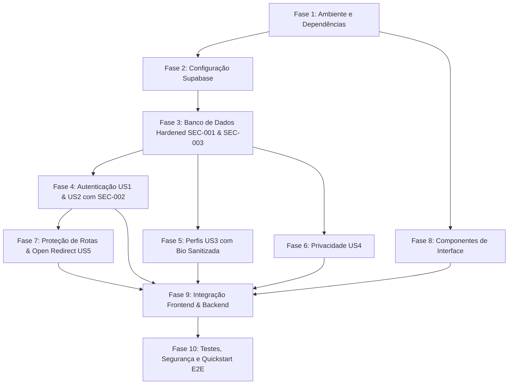

# Tasks: Feature 001 — Authentication & User Profiles

**Input**: Documentos de design de `/specs/001-auth-user-profiles/`  
**Prerequisites**: [constitution.md](../../.specify/memory/constitution.md), [spec.md](spec.md), [plan.md](plan.md), [research.md](research.md), [data-model.md](data-model.md), [contracts/auth-contracts.md](contracts/auth-contracts.md), [quickstart.md](quickstart.md)  
**Security Status**: Hardened (SEC-001, SEC-002, SEC-003 e melhorias de segurança incorporadas)  
**Organization**: Estruturado em 10 fases lógicas e sequenciais conforme requerido, associando tarefas a histórias de usuário (`[US1]`, `[US2]`, `[US3]`, `[US4]`, `[US5]`) para possibilitar testes e entregas progressivas.

## Convenções de Formato
- `- [ ] [TaskID] [P?] [Story?] Descrição objetiva com caminho exato de arquivo`
- **[P]**: Tarefa paralelizável (arquivos independentes, sem bloqueios de tarefas incompletas)
- **[Story]**: Mapeamento para as histórias de usuário da especificação (`[US1]` a `[US5]`)

---

## Fase 1: Preparação do Ambiente e Dependências

**Propósito**: Inicialização do ecossistema Next.js, ferramentas de compilação, tipagem e estilo dark gaming.

- [ ] T001 Inicializar a estrutura do projeto Next.js 14+ com App Router e TypeScript em package.json e tsconfig.json  
  *Critério de Conclusão*: Projeto inicializado com scripts `dev`, `build`, `start` e `lint`, configurado com strict mode no TypeScript.
- [ ] T002 [P] Instalar as dependências obrigatórias (`@supabase/ssr`, `@supabase/supabase-js`, `zod`, `clsx`, `tailwind-merge`) em package.json  
  *Critério de Conclusão*: Pacotes listados em `dependencies` e bloqueados em lockfile sem conflitos de resolução.
- [ ] T003 [P] Configurar o tema visual escuro com paleta voltada ao universo gamer em tailwind.config.ts e app/globals.css  
  *Critério de Conclusão*: Variáveis CSS e classes Tailwind configuradas com tema escuro padrão (tons de slate/zinc e violeta como acento).
- [ ] T004 [P] Configurar validação estrita de variáveis de ambiente com Zod em lib/env.ts  
  *Critério de Conclusão*: `NEXT_PUBLIC_SUPABASE_URL` e `NEXT_PUBLIC_SUPABASE_ANON_KEY` validadas em runtime, com bloqueio explícito de chaves administrativas (`service_role`) no cliente.

---

## Fase 2: Configuração e Infraestrutura do Supabase

**Propósito**: Implementação dos utilitários de comunicação com o Supabase Auth e PostgreSQL utilizando `@supabase/ssr`.

- [ ] T005 [P] Implementar a fábrica do cliente Supabase para o navegador via `createBrowserClient` em lib/supabase/client.ts  
  *Critério de Conclusão*: Instância singleton tipada para uso em Client Components.
- [ ] T006 [P] Implementar a fábrica do cliente Supabase para Server Components e Server Actions com atributos de cookies seguros (`httpOnly: true`, `secure: true`, `sameSite: 'lax'`, `path: '/'`) em lib/supabase/server.ts  
  *Critério de Conclusão*: Métodos `getAll` e `setAll` configurados usando `cookies()` do Next.js com as opções de segurança de cookies padronizadas.
- [ ] T007 [P] Implementar o helper de sincronização e renovação de sessão para o middleware em lib/supabase/middleware.ts  
  *Critério de Conclusão*: Leitura e renovação segura de sessão sem execução de mutações desnecessárias no banco.
- [ ] T008 [P] Gerar e estruturar as definições de tipos TypeScript da base de dados Supabase em types/database.ts  
  *Critério de Conclusão*: Tipos `Row`, `Insert`, `Update` e `Relationships` para o esquema `public.profiles`.

---

## Fase 3: Estruturação do Banco de Dados e Migrações (Hardened SEC-001 & SEC-003)

**Propósito**: Modelagem relacional, constraints rigorosas, gatilhos de automação protegidos contra search path hijacking, bloqueio de imutabilidade e políticas de Row Level Security (RLS).

- [ ] T009 Criar script de migração SQL da tabela `public.profiles` com chave estrangeira `id REFERENCES auth.users(id) ON DELETE CASCADE`, constraints verbatim (`char_length(username) >= 3 AND char_length(username) <= 20`, `username ~ '^[a-zA-Z0-9_-]+$'`, `char_length(display_name) >= 2 AND char_length(display_name) <= 50`, `bio IS NULL OR char_length(bio) <= 300`), índice único case-insensitive `LOWER(username)` (SEC-002) e valores padrão de privacidade (`is_profile_public DEFAULT false`, `is_library_public DEFAULT false`) em supabase/migrations/20261107000000_create_profiles.sql  
  *Critério de Conclusão*: DDL executável criando a tabela com integridade relacional, índice único case-insensitive e checks.
- [ ] T010 [P] Implementar trigger `on_profiles_updated` para atualização de timestamps e trigger `protect_username_immutability` com `BEFORE UPDATE ON public.profiles` impedindo alterações no campo `username` (SEC-003) em supabase/migrations/20261107000000_create_profiles.sql  
  *Critério de Conclusão*: Triggers plpgsql que atualizam `updated_at` e disparam exceção caso `NEW.username <> OLD.username`, mesmo em chamadas diretas via API do Supabase.
- [ ] T011 Implementar função plpgsql `handle_new_user` configurada com `SECURITY DEFINER SET search_path = public, pg_temp`, qualificações explícitas de schema e restrição de privilégios (`REVOKE ALL FROM PUBLIC; GRANT TO postgres, supabase_auth_admin;`) associada ao trigger `AFTER INSERT ON auth.users` (SEC-001) em supabase/migrations/20261107000000_create_profiles.sql  
  *Critério de Conclusão*: Criação atômica e consistente de linha em `profiles` a cada novo registro em `auth.users`, protegida contra sequestro de search_path e com privacidade privada por padrão.
- [ ] T012 Habilitar RLS (`ENABLE ROW LEVEL SECURITY`) e definir políticas granulares de leitura, inserção, atualização e exclusão na tabela `public.profiles` em supabase/migrations/20261107000000_create_profiles.sql  
  *Critério de Conclusão*: Políticas configuradas: leitura (`auth.uid() = id OR is_profile_public = true`), inserção (`auth.uid() = id`), atualização (`auth.uid() = id` com `CHECK (auth.uid() = id)`) e exclusão (`auth.uid() = id`).
- [ ] T013 [P] Criar testes automatizados de integração para validação das regras e políticas de banco de dados (trigger SEC-001, unicidade SEC-002 e imutabilidade SEC-003) em tests/integration/database-rls.test.ts  
  *Critério de Conclusão*: Testes verificando trigger atômico, rejeição de username duplicado, bloqueio de consultas RLS para perfis privados e exceção ao tentar alterar username.

---

## Fase 4: Implementação da Autenticação (Defesa em Profundidade SEC-002)

**Propósito**: Regras de negócio, esquemas de validação Zod e Server Actions para cadastro com verificação prévia, login e logout.

- [ ] T014 [P] [US1] Criar testes unitários para validação de regras de cadastro em tests/unit/register-schema.test.ts  
  *Critério de Conclusão*: Cobertura de testes para formatos de e-mail inválidos, senhas com menos de 8 caracteres ou sem números, e restrições de username.
- [ ] T015 [P] [US1] Implementar schema Zod `registerSchema` com validações de e-mail, requisitos de senha e username alfanumérico em schemas/auth.ts  
  *Critério de Conclusão*: Schema exportando tipos TypeScript inferidos (`RegisterInput`).
- [ ] T016 [US1] Implementar método auxiliar `checkUsernameAvailability`, método de negócio `signUp` com verificação prévia de username (SEC-002) e tratamento de erro de colisão no commit (`PostgreSQL 23505`) em services/auth-service.ts  
  *Critério de Conclusão*: Registro executado via Supabase Auth com retorno padronizado `ActionResponse`, impedindo usernames duplicados com mensagem amigável e tratamento de condições de corrida.
- [ ] T017 [P] [US2] Criar testes unitários para validação de regras de login em tests/unit/login-schema.test.ts  
  *Critério de Conclusão*: Cobertura de testes para entradas válidas e mensagens de erro de campos obrigatórios.
- [ ] T018 [P] [US2] Implementar schema Zod `loginSchema` em schemas/auth.ts  
  *Critério de Conclusão*: Schema validando e-mail e senha com mensagens em português.
- [ ] T019 [US2] Implementar métodos `signInWithPassword` e `signOut` e respectivas Server Actions com sanitização de `returnTo` e manipulação segura de cookies em services/auth-service.ts  
  *Critério de Conclusão*: Autenticação estabelecendo sessão em cookie `httpOnly` e logout revogando a sessão ativa.

---

## Fase 5: Implementação dos Perfis de Usuário (Hardening SEC-003)

**Propósito**: Serviços e regras de negócio para recuperação, atualização de dados cadastrais com sanitização de bio e visualização de perfis.

- [ ] T020 [P] [US3] Criar testes unitários para o schema de edição de perfil em tests/unit/profile-schema.test.ts  
  *Critério de Conclusão*: Testes para limites de tamanho de display name (2 a 50 caracteres), sanitização de bio com `.trim()` (máximo 300) e URL de avatar.
- [ ] T021 [P] [US3] Implementar schema Zod `updateProfileSchema` com sanitização e normalização de `bio` via `.trim()` e omissão estrita do campo `username` em schemas/profile.ts  
  *Critério de Conclusão*: Validação estrita dos campos editáveis do perfil, garantindo a imutabilidade do username na camada de aplicação.
- [ ] T022 [US3] Implementar método de consulta `getCurrentProfile` para carregar o perfil do usuário autenticado no servidor em services/profile-service.ts  
  *Critério de Conclusão*: Consulta tipada retornando `UserProfile` ou nulo se não autenticado.
- [ ] T023 [US3] Implementar método `updateProfile` e Server Action para atualização de perfil com revalidação de cache em services/profile-service.ts  
  *Critério de Conclusão*: Mutação restrita ao `auth.uid()` com chamada a `revalidatePath('/profile')`.
- [ ] T024 [P] [US3] Implementar método de consulta `getPublicProfileByUsername` para visualização de perfis públicos em services/profile-service.ts  
  *Critério de Conclusão*: Retorno de `PublicUserProfile` ou nulo caso o perfil esteja configurado como privado.

---

## Fase 6: Implementação das Configurações de Privacidade

**Propósito**: Controle independente de privacidade para perfil e biblioteca de jogos.

- [ ] T025 [P] [US4] Implementar schema Zod `updatePrivacySchema` validando os booleanos `is_profile_public` e `is_library_public` em schemas/profile.ts  
  *Critério de Conclusão*: Validação garantindo que ambas as preferências sejam booleanos explícitos.
- [ ] T026 [US4] Implementar método `updatePrivacy` e Server Action para alternância de privacidade em services/profile-service.ts  
  *Critério de Conclusão*: Persistência independente das flags de privacidade com garantia de que a alteração do perfil não altere a biblioteca.
- [ ] T027 [P] [US4] Criar testes de integração para o serviço de privacidade e isolamento em tests/integration/privacy-service.test.ts  
  *Critério de Conclusão*: Testes garantindo que perfis privados não são retornados para chamadores anônimos.

---

## Fase 7: Proteção de Rotas e Sessões (Prevenção de Open Redirect)

**Propósito**: Interceptação em nível de servidor com `middleware.ts`, proteção contra Open Redirect e codificação segura de parâmetros.

- [ ] T028 [US5] Implementar o middleware de proteção de rotas privadas (`/profile`, `/settings/*`) com codificação de parâmetro `encodeURIComponent` e função `sanitizeRedirectUrl` para prevenir Open Redirect em middleware.ts  
  *Critério de Conclusão*: Interceptação no servidor com validação de token via `supabase.auth.getUser()`, sem renderização de páginas privadas para deslogados e redirecionamento restrito a rotas internas relativas.
- [ ] T029 [US5] Implementar redirecionamento automático de usuários já autenticados que acessam `/login` e `/register` para `/profile` em middleware.ts  
  *Critério de Conclusão*: Usuários com sessão ativa são direcionados diretamente à área interna.
- [ ] T030 [P] [US5] Criar testes de integração automatizados para o middleware (incluindo testes de bloqueio de Open Redirect com URLs absolutas e `//malicious.com`) em tests/integration/middleware.test.ts  
  *Critério de Conclusão*: Testes verificando respostas HTTP 307 de redirecionamento seguro para rotas protegidas.

---

## Fase 8: Desenvolvimento das Interfaces

**Propósito**: Construção de componentes visuais reutilizáveis em tema escuro e formulários interativos.

- [ ] T031 [P] Criar componentes base de UI em tema escuro (`Button`, `Input`, `Card`, `Toggle`, `Alert`) em components/ui/button.tsx, components/ui/input.tsx, components/ui/card.tsx, components/ui/toggle.tsx e components/ui/alert.tsx  
  *Critério de Conclusão*: Componentes acessíveis, responsivos e estilizados com Tailwind CSS no padrão dark gaming.
- [ ] T032 [P] [US1] Desenvolver o formulário interativo de cadastro `RegisterForm` com feedback inline de validação e verificação de disponibilidade em components/auth/register-form.tsx  
  *Critério de Conclusão*: Formulário com campos de e-mail, senha, confirmação e username com estados de loading e erro.
- [ ] T033 [P] [US2] Desenvolver o formulário interativo de login `LoginForm` em components/auth/login-form.tsx  
  *Critério de Conclusão*: Formulário com tratamento de credenciais inválidas e suporte ao parâmetro seguro `returnTo`.
- [ ] T034 [P] [US2] Desenvolver o componente de cabeçalho e sessão `UserNav` com botão de logout em components/auth/user-nav.tsx  
  *Critério de Conclusão*: Exibição de avatar/nome e ação de encerramento de sessão imediata.
- [ ] T035 [P] [US3] Desenvolver o card de exibição de perfil `ProfileCard` em components/profile/profile-card.tsx  
  *Critério de Conclusão*: Renderização de username único (imutável), display name, bio, avatar e data de criação.
- [ ] T036 [P] [US3] Desenvolver o formulário de edição de dados cadastrais `ProfileEditForm` em components/profile/profile-edit-form.tsx  
  *Critério de Conclusão*: Formulário pré-preenchido com feedback visual de sucesso ao salvar (sem campo de username editável).
- [ ] T037 [P] [US4] Desenvolver o componente de configurações de privacidade `PrivacySettingsForm` em components/profile/privacy-settings-form.tsx  
  *Critério de Conclusão*: Toggles independentes para visibilidade do perfil e da biblioteca, com indicação clara do modo Privado.

---

## Fase 9: Integração entre Frontend e Backend

**Propósito**: Montagem das páginas do Next.js integrando Server Components, Server Actions e componentes interativos.

- [ ] T038 [US1] Montar a página pública de cadastro em app/(auth)/register/page.tsx  
  *Critério de Conclusão*: Rota `/register` acessível e integrada com `RegisterForm` e tratamento de erros de duplicidade.
- [ ] T039 [US2] Montar a página pública de autenticação em app/(auth)/login/page.tsx  
  *Critério de Conclusão*: Rota `/login` acessível, capturando e sanitizando query parameters de redirecionamento.
- [ ] T040 [US2] Integrar o componente de navegação `UserNav` no layout global em app/layout.tsx  
  *Critério de Conclusão*: Barra superior persistente em toda a aplicação exibindo status do usuário e atalho para o perfil.
- [ ] T041 [US3] Montar a página protegida de perfil como Server Component consumindo `getCurrentProfile` em app/(dashboard)/profile/page.tsx  
  *Critério de Conclusão*: Rota `/profile` renderizando os dados atualizados do usuário autenticado.
- [ ] T042 [US3] [US4] Montar a página protegida de edição e preferências em app/(dashboard)/settings/profile/page.tsx  
  *Critério de Conclusão*: Rota `/settings/profile` unindo `ProfileEditForm` e `PrivacySettingsForm` com persistência funcional.

---

## Fase 10: Testes Funcionais, de Segurança e Validação (Validação Integral)

**Propósito**: Verificação de conformidade de ponta a ponta, testes de segurança de banco e validação com o guia quickstart.

- [ ] T043 [P] Executar e validar a suíte completa de testes unitários para schemas e utilitários em tests/unit/  
  *Critério de Conclusão*: 100% de aprovação nos testes de esquemas Zod (cadastro, login, perfil com bio sanitizada, privacidade).
- [ ] T044 [P] Executar testes de integração do fluxo completo de autenticação em tests/integration/auth-flow.test.ts  
  *Critério de Conclusão*: Sucesso nos testes de ciclo de vida: cadastro com checagem de username -> login -> persistência de sessão -> logout.
- [ ] T045 [P] Executar testes de isolamento de segurança, validação do trigger de imutabilidade do username (SEC-003) e políticas RLS em tests/integration/security-isolation.test.ts  
  *Critério de Conclusão*: Validação de que usuários não autenticados ou terceiros não conseguem modificar perfis alheios, que o trigger impede update de username e que perfis privados não vazam via query.
- [ ] T046 [P] Executar auditoria de segurança para garantir a ausência de chaves administrativas (`service_role`) no código do cliente  
  *Critério de Conclusão*: Verificação por script/grep confirmando que nenhuma chave sensível vaza para o build do Next.js.
- [ ] T047 Executar validação ponta a ponta seguindo o roteiro do guia quickstart (Cenários 1 a 6) em specs/001-auth-user-profiles/quickstart.md  
  *Critério de Conclusão*: Todos os cenários (incluindo teste de imutabilidade do username e colisão de cadastro) validados com sucesso.

---

## Grafo de Dependências entre Fases

---

## Oportunidades de Execução Paralela (`[P]`)

- **Setup & Configuração**: T002, T003 e T004 podem rodar em paralelo após T001. Na Fase 2, T005, T006, T007 e T008 podem ser desenvolvidos concomitantemente.
- **Banco de Dados**: T010 e T013 podem ser implementados e testados em paralelo à criação dos esquemas SQL.
- **Componentes de UI**: Todos os componentes da Fase 8 (`T031` a `T037`) podem ser estilizados em paralelo à implementação das Server Actions das Fases 4, 5 e 6.
- **Suíte de Testes**: Os testes unitários (`T043`), de fluxo (`T044`), de isolamento e imutabilidade (`T045`) e a auditoria de chaves (`T046`) na Fase 10 podem ser disparados simultaneamente.

---

## Estratégia de Entrega Incremental e MVP

1. **Marco MVP 1 (Fundação Blindada):** Fases 1, 2, 3 e 4 concluídas. Usuários já conseguem se cadastrar com checagem de username e ter seus perfis gerados atomicamente por trigger seguro `SECURITY DEFINER SET search_path = public, pg_temp`.
2. **Marco MVP 2 (Segurança de Rotas e Redirecionamento):** Fase 7 concluída. Nenhuma área privada pode ser acessada sem sessão válida e os redirecionamentos são protegidos contra Open Redirect.
3. **Marco MVP 3 (Gestão de Identidade e Privacidade):** Fases 5, 6, 8 e 9 concluídas. Usuários visualizam e editam seus perfis (com username imutável protegido no banco) e configuram a visibilidade com isolamento garantido.
4. **Marco Final (Qualidade Assegurada):** Fase 10 concluída com validação integral dos 6 cenários do `quickstart.md`.
