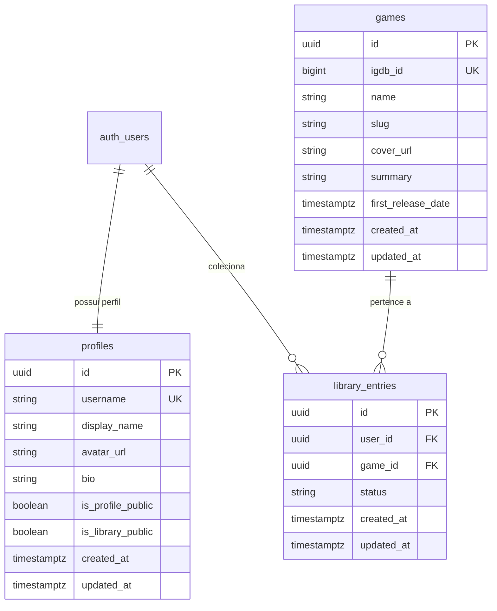

# Data Model: 002 — Game Catalog & Personal Library

**Feature**: Feature 002 — Game Catalog & Personal Library  
**Date**: 08/11/2026  
**Status**: Aprovado para Migração SQL

---

## 1. Diagrama de Relacionamento de Entidades (ERD)



---

## 2. Esquema DDL do PostgreSQL

### Tabela `public.games`

```sql
CREATE TABLE IF NOT EXISTS public.games (
  id UUID PRIMARY KEY DEFAULT gen_random_uuid(),
  igdb_id BIGINT UNIQUE NOT NULL,
  name TEXT NOT NULL,
  slug TEXT NULL,
  cover_url TEXT NULL,
  summary TEXT NULL,
  first_release_date TIMESTAMPTZ NULL,
  created_at TIMESTAMPTZ NOT NULL DEFAULT timezone('utc'::text, now()),
  updated_at TIMESTAMPTZ NOT NULL DEFAULT timezone('utc'::text, now())
);

-- Índices de consulta rápida
CREATE INDEX IF NOT EXISTS idx_games_igdb_id ON public.games (igdb_id);
CREATE INDEX IF NOT EXISTS idx_games_name_lower ON public.games (LOWER(name));
```

### Tabela `public.library_entries`

```sql
CREATE TABLE IF NOT EXISTS public.library_entries (
  id UUID PRIMARY KEY DEFAULT gen_random_uuid(),
  user_id UUID NOT NULL REFERENCES auth.users(id) ON DELETE CASCADE,
  game_id UUID NOT NULL REFERENCES public.games(id) ON DELETE CASCADE,
  status TEXT NOT NULL,
  created_at TIMESTAMPTZ NOT NULL DEFAULT timezone('utc'::text, now()),
  updated_at TIMESTAMPTZ NOT NULL DEFAULT timezone('utc'::text, now()),

  -- Regra Constitucional §4.2: Um mesmo usuário não pode adicionar o mesmo jogo duas vezes
  CONSTRAINT uq_library_user_game UNIQUE (user_id, game_id),

  -- Regra Constitucional §4.2: Três status permitidos estritamente
  CONSTRAINT chk_library_status CHECK (status IN ('want_to_play', 'playing', 'completed'))
);

-- Índices de filtragem
CREATE INDEX IF NOT EXISTS idx_library_entries_user_id ON public.library_entries (user_id);
CREATE INDEX IF NOT EXISTS idx_library_entries_game_id ON public.library_entries (game_id);
CREATE INDEX IF NOT EXISTS idx_library_entries_status ON public.library_entries (user_id, status);
```

### Triggers de Atualização Automática de `updated_at`

```sql
DROP TRIGGER IF EXISTS on_games_updated ON public.games;
CREATE TRIGGER on_games_updated
  BEFORE UPDATE ON public.games
  FOR EACH ROW
  EXECUTE FUNCTION public.handle_updated_at();

DROP TRIGGER IF EXISTS on_library_entries_updated ON public.library_entries;
CREATE TRIGGER on_library_entries_updated
  BEFORE UPDATE ON public.library_entries
  FOR EACH ROW
  EXECUTE FUNCTION public.handle_updated_at();
```

---

## 3. Políticas de Segurança (Row Level Security - RLS)

### Políticas para `public.games`

```sql
ALTER TABLE public.games ENABLE ROW LEVEL SECURITY;

-- Catálogo de jogos é público para leitura de qualquer usuário (anônimo ou autenticado)
CREATE POLICY "Jogos visíveis publicamente para leitura"
  ON public.games
  FOR SELECT
  USING (true);

-- Apenas usuários autenticados podem salvar jogos na base sob demanda
CREATE POLICY "Usuários autenticados podem inserir jogos"
  ON public.games
  FOR INSERT
  TO authenticated
  WITH CHECK (true);

CREATE POLICY "Usuários autenticados podem atualizar dados de jogos"
  ON public.games
  FOR UPDATE
  TO authenticated
  USING (true)
  WITH CHECK (true);
```

### Políticas para `public.library_entries`

```sql
ALTER TABLE public.library_entries ENABLE ROW LEVEL SECURITY;

-- Leitura: O proprietário visualiza sempre; terceiros só visualizam se o dono tiver is_library_public = true no perfil
CREATE POLICY "Leitura de biblioteca por dono ou perfil com biblioteca pública"
  ON public.library_entries
  FOR SELECT
  USING (
    auth.uid() = user_id
    OR
    EXISTS (
      SELECT 1 FROM public.profiles
      WHERE profiles.id = library_entries.user_id
        AND profiles.is_library_public = true
    )
  );

-- Inserção: Usuário só adiciona jogos à própria biblioteca
CREATE POLICY "Usuário só pode adicionar jogos à própria biblioteca"
  ON public.library_entries
  FOR INSERT
  TO authenticated
  WITH CHECK (auth.uid() = user_id);

-- Atualização: Usuário só altera status de seus próprios jogos
CREATE POLICY "Usuário só pode alterar entradas da própria biblioteca"
  ON public.library_entries
  FOR UPDATE
  TO authenticated
  USING (auth.uid() = user_id)
  WITH CHECK (auth.uid() = user_id);

-- Exclusão: Usuário só remove jogos da própria biblioteca
CREATE POLICY "Usuário só pode remover jogos da própria biblioteca"
  ON public.library_entries
  FOR DELETE
  TO authenticated
  USING (auth.uid() = user_id);
```

---

## 4. Tipos TypeScript e Enums

```ts
export type LibraryGameStatus = "want_to_play" | "playing" | "completed";

export interface Game {
  id: string;
  igdb_id: number;
  name: string;
  slug: string | null;
  cover_url: string | null;
  summary: string | null;
  first_release_date: string | null;
  created_at: string;
  updated_at: string;
}

export interface LibraryEntry {
  id: string;
  user_id: string;
  game_id: string;
  status: LibraryGameStatus;
  created_at: string;
  updated_at: string;
  game?: Game;
}
```

