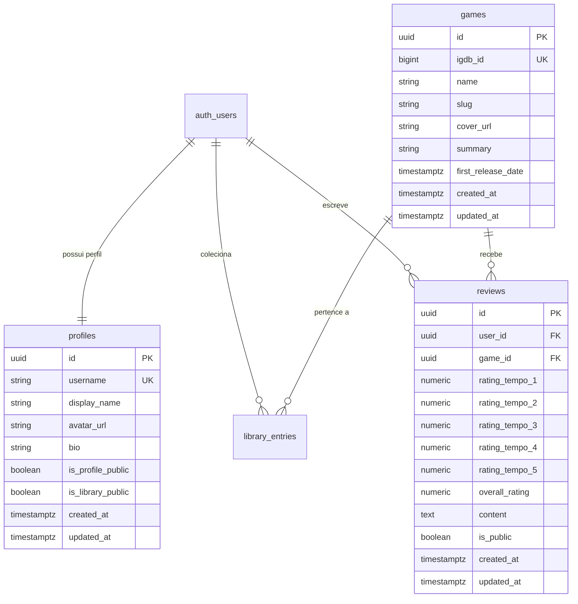

# Data Model: 003 — Progressive Game Reviews & Ratings

**Feature**: Feature 003 — Progressive Game Reviews & Ratings  
**Date**: 10/11/2026  
**Status**: Aprovado para Migração SQL

---

## 1. Diagrama de Relacionamento de Entidades (ERD)



---

## 2. Esquema DDL do PostgreSQL

```sql
-- ===========================================================================
-- Tabela public.reviews — Avaliações Progressivas e Reviews de Jogos
-- ===========================================================================

CREATE TABLE IF NOT EXISTS public.reviews (
  id UUID PRIMARY KEY DEFAULT gen_random_uuid(),
  user_id UUID NOT NULL REFERENCES auth.users(id) ON DELETE CASCADE,
  game_id UUID NOT NULL REFERENCES public.games(id) ON DELETE CASCADE,
  
  -- Notas dos 5 Tempos de Gameplay (0.0 a 10.0 com precisão decimal)
  rating_tempo_1 NUMERIC(4,2) NOT NULL,
  rating_tempo_2 NUMERIC(4,2) NOT NULL,
  rating_tempo_3 NUMERIC(4,2) NOT NULL,
  rating_tempo_4 NUMERIC(4,2) NOT NULL,
  rating_tempo_5 NUMERIC(4,2) NOT NULL,
  overall_rating NUMERIC(4,2) NOT NULL,
  
  -- Texto dissertativo opcional
  content TEXT NULL,
  
  -- Visibilidade da avaliação (Pública por padrão)
  is_public BOOLEAN NOT NULL DEFAULT true,
  
  created_at TIMESTAMPTZ NOT NULL DEFAULT timezone('utc'::text, now()),
  updated_at TIMESTAMPTZ NOT NULL DEFAULT timezone('utc'::text, now()),

  -- Regra Constitucional: Um usuário só pode ter uma avaliação por jogo
  CONSTRAINT uq_reviews_user_game UNIQUE (user_id, game_id),

  -- Validações de limites numéricos (0.0 a 10.0)
  CONSTRAINT chk_review_rating_tempo_1 CHECK (rating_tempo_1 >= 0.0 AND rating_tempo_1 <= 10.0),
  CONSTRAINT chk_review_rating_tempo_2 CHECK (rating_tempo_2 >= 0.0 AND rating_tempo_2 <= 10.0),
  CONSTRAINT chk_review_rating_tempo_3 CHECK (rating_tempo_3 >= 0.0 AND rating_tempo_3 <= 10.0),
  CONSTRAINT chk_review_rating_tempo_4 CHECK (rating_tempo_4 >= 0.0 AND rating_tempo_4 <= 10.0),
  CONSTRAINT chk_review_rating_tempo_5 CHECK (rating_tempo_5 >= 0.0 AND rating_tempo_5 <= 10.0),
  CONSTRAINT chk_review_overall_rating CHECK (overall_rating >= 0.0 AND overall_rating <= 10.0),

  -- Limite razoável de caracteres no texto
  CONSTRAINT chk_review_content_length CHECK (content IS NULL OR char_length(content) <= 2500)
);

-- Índices de consulta rápida
CREATE INDEX IF NOT EXISTS idx_reviews_game_id ON public.reviews (game_id);
CREATE INDEX IF NOT EXISTS idx_reviews_user_id ON public.reviews (user_id);
CREATE INDEX IF NOT EXISTS idx_reviews_public ON public.reviews (game_id, is_public);

-- Trigger de updated_at (reutiliza handle_updated_at da Feature 001)
DROP TRIGGER IF EXISTS on_reviews_updated ON public.reviews;
CREATE TRIGGER on_reviews_updated
  BEFORE UPDATE ON public.reviews
  FOR EACH ROW
  EXECUTE FUNCTION public.handle_updated_at();
```

---

## 3. Políticas de Segurança (Row Level Security - RLS)

```sql
ALTER TABLE public.reviews ENABLE ROW LEVEL SECURITY;

-- Leitura: Avaliações públicas visíveis para todos; privadas visíveis apenas pelo autor
CREATE POLICY "Leitura de avaliações públicas ou próprias"
  ON public.reviews
  FOR SELECT
  USING (
    is_public = true
    OR
    auth.uid() = user_id
  );

-- Inserção: Apenas usuários autenticados criando avaliações com seu próprio user_id
CREATE POLICY "Usuários autenticados criam suas próprias avaliações"
  ON public.reviews
  FOR INSERT
  TO authenticated
  WITH CHECK (auth.uid() = user_id);

-- Atualização: Usuário só edita suas próprias avaliações
CREATE POLICY "Usuários editam apenas suas próprias avaliações"
  ON public.reviews
  FOR UPDATE
  TO authenticated
  USING (auth.uid() = user_id)
  WITH CHECK (auth.uid() = user_id);

-- Exclusão: Usuário só remove suas próprias avaliações
CREATE POLICY "Usuários excluem apenas suas próprias avaliações"
  ON public.reviews
  FOR DELETE
  TO authenticated
  USING (auth.uid() = user_id);
```

---

## 4. Tipos TypeScript e Interfaces

```ts
export interface ReviewAuthor {
  id: string;
  username: string;
  display_name: string;
  avatar_url: string | null;
}

export interface GameReview {
  id: string;
  user_id: string;
  game_id: string;
  rating_tempo_1: number;
  rating_tempo_2: number;
  rating_tempo_3: number;
  rating_tempo_4: number;
  rating_tempo_5: number;
  overall_rating: number;
  content: string | null;
  is_public: boolean;
  created_at: string;
  updated_at: string;
  author?: ReviewAuthor;
  game?: {
    id: string;
    igdb_id: number;
    name: string;
    cover_url: string | null;
  };
}

export interface GameRatingSummary {
  total_reviews: number;
  overall_average: number | null;
  tempo_1_average: number | null;
  tempo_2_average: number | null;
  tempo_3_average: number | null;
  tempo_4_average: number | null;
  tempo_5_average: number | null;
}
```

